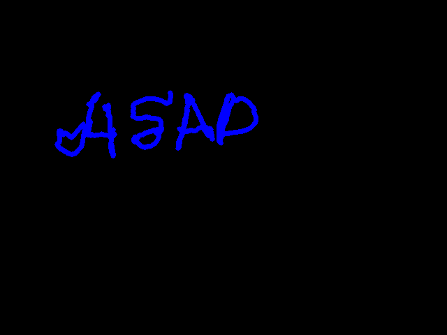

# Day 02 — AirCanvas

A webcam-powered sketchpad controlled by a hand gesture. Bring your thumb and index fingertips together to draw, move your hand to guide the line, and separate your fingertips to lift the pen.

## Features

- Live hand tracking with a mirrored camera view.
- Pinch to draw; release to move without leaving a line.
- Four brush colors: red, green, blue, and yellow.
- Clear the canvas or export a drawing as a PNG.
- Reset the stroke when the hand leaves view, avoiding a line across the gap when it returns.

## Setup on macOS

Install [uv](https://docs.astral.sh/uv/getting-started/installation/) if it is not already available. From the repository root, run:

```bash
cd 02-aircanvas
uv venv --python 3.12
uv pip install "mediapipe==0.10.21" "opencv-contrib-python==4.11.0.86" "numpy==1.26.4"
```

These versions match the Python environment used for this project. MediaPipe is pinned because the code uses its legacy Hands interface.

## Run

From inside `02-aircanvas`:

```bash
.venv/bin/python main.py
```

For subsequent runs from anywhere on the development Mac:

```bash
cd ~/Documents/GitHub/30daychallenge/02-aircanvas
.venv/bin/python main.py
```

Allow camera access if macOS asks. Keep Terminal open while the app runs, and click the AirCanvas window before using keyboard controls.

## Controls

| Gesture or key | Action |
| --- | --- |
| Pinch thumb and index fingertips together, then move | Draw |
| Separate the fingertips | Lift the pen |
| **1** | Red brush |
| **2** | Green brush |
| **3** | Blue brush |
| **4** | Yellow brush |
| **C** | Clear the canvas |
| **S** | Save to `drawing.png` beside `main.py` |
| **Q** | Quit |

Each save replaces the previous `drawing.png`. Rename or copy the saved image before saving again if you want to keep multiple drawings. The PNG contains the drawing on a black background, without the webcam view or interface.

## How it works

OpenCV reads camera frames. MediaPipe locates the hand landmarks, including the thumb tip and index fingertip. Their separation is divided by an estimate of hand size so the gesture can work at different camera distances.

A small gap starts a stroke; a larger gap lifts the pen. Using different start and stop thresholds reduces rapid switching near the boundary. NumPy holds a separate canvas, and OpenCV joins successive fingertip positions to create each stroke.

## Example drawing



## Troubleshooting

- **Camera unavailable:** close RockLook, Photo Booth, FaceTime, or another app using the camera, then restart AirCanvas.
- **No hand detected:** improve the lighting and keep the whole hand visible.
- **Drawing does not start:** bring the thumb and index fingertips closer together.
- **Keys do not respond:** click the AirCanvas window and use lowercase C/S/Q, without holding Shift.
- **File not found:** make sure Terminal is inside `02-aircanvas` before running the command.
- **Missing module:** use the project's `.venv/bin/python` rather than a different Python installation.

## Learning notes

This project practices hand landmarks, coordinate conversion, gesture thresholds, persistent image buffers, keyboard input, and saving image files.

Possible future additions: an eraser, brush-size controls, and undo.
