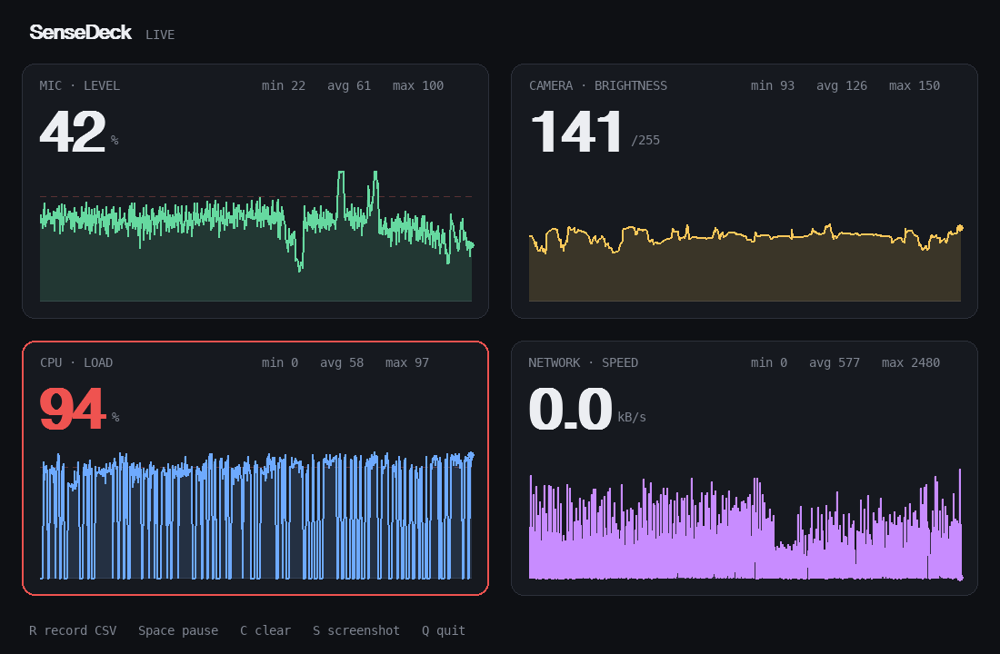

# SenseDeck — Day 20

Turn your laptop into a live sensor dashboard. SenseDeck reads the **microphone, camera, CPU, and network** 10 times a second, shows each one as a big number with a 60-second graph, and can record everything to a CSV file.

New to Python? Start with the [general beginner guide](../BEGINNER_GUIDE.md). It explains installing tools, environments, Terminal commands, commits, and pushing work to GitHub.

Inspired by [KMechanic/SensorLogger](https://github.com/KMechanic/SensorLogger). SenseDeck is our own pygame version with four live panels, alert lines, min/avg/max stats, CSV recording, a demo mode with fake sensors, and a self-test.



## What it is, in simple terms

Your laptop is full of sensors you never look at:

| Panel | What it measures | Try it |
| --- | --- | --- |
| **Mic** | How loud the room is, 0 to 100 | Clap: it jumps and the panel turns red |
| **Camera** | How bright the camera view is, 0 to 255 | Cover the camera: it drops to about 0 |
| **CPU** | How hard the computer is working, in % | Open many tabs: it goes up |
| **Network** | How fast data moves, in kB per second | Play a video: it rises |

A program that reads sensors again and again, shows them live, and saves them to a file is called a **data logger**. That is what SenseDeck is.

### How each number is made

- **Mic:** take 2048 sound samples, compute their **RMS** (average strength), turn it into **decibels**, then map −60 dB…0 dB to 0…100.
- **Camera:** shrink each frame and average its brightness, weighting green most because human eyes are most sensitive to green.
- **CPU:** ask the operating system how busy the processor was over the last half second.
- **Network:** read the total bytes sent and received, and divide the difference by the time passed.

CPU and network are measured over **half-second windows**. macOS updates those counters in steps, so reading them 10 times a second would show fake zeros between real values.

## Where it is used in real life

- **Phones and smartwatches:** step counters, auto-brightness, and noise alerts read sensors the same way.
- **Science and weather stations:** data loggers record temperature, light, and sound to files for later study.
- **Server dashboards:** tools like Grafana show CPU and network graphs so engineers notice overloads.
- **Factories and IoT:** machines are watched by sensors with alert lines, just like the red dashed lines here.

### How it connects to earlier days

| Day | Project | Link |
| --- | --- | --- |
| 15 | [AudioScope](../15-audioscope/) | Also reads the mic, but shows which frequencies are in the sound |
| 19 | [BusTalk](../19-bustalk/) | How real sensor chips send readings to a computer |
| 20 | SenseDeck | What you do with the readings once they arrive |

No AI model is used today.

## Before starting

You need Python 3.12, uv, a microphone, and a webcam. The packages are `pygame`, `numpy`, `psutil`, `sounddevice`, and `opencv-python`, listed in `requirements.txt`. Installing them needs internet once; OpenCV is the biggest download. The example setup is macOS-first.

## Files

| Item | Purpose |
| --- | --- |
| `main.py` | Sensors, math, dashboard drawing, CSV recorder, controls, and self-test |
| `requirements.txt` | Package versions used when this project was built |
| `.gitignore` | Excludes the environment, cache files, saved screenshots, and CSV logs |
| `screenshot.png` | Example dashboard shown above |
| `example_log.csv` | Example recording made with **R** |
| `.venv/` | Local Python environment |

## First-time setup

Paste this in Terminal as one line. It starts with `cd`, so it works from any folder:

```bash
cd ~/Documents/GitHub/30daychallenge/20-sensedeck && uv venv --python 3.12 && uv pip install -r requirements.txt && ls -a
```

The list should show `.venv` and `main.py`. If you ran the setup in your home folder by mistake, you will have a `~/20-sensedeck` folder; move it into the repo and rebuild `.venv`, because a moved environment stops working.

## Check, then run

```bash
.venv/bin/python main.py --test && .venv/bin/python main.py
```

The check should end with:

```
12/12 checks passed
```

It checks RMS, decibels, the 0–100 mic scale, camera brightness, network speed, the rolling history, graph placement, the CSV recorder, and the demo sensors.

The first real run makes macOS ask Terminal for **Camera** and **Microphone** permission. Allow both, then restart SenseDeck.

## Options

| Command | What it does |
| --- | --- |
| `.venv/bin/python main.py` | Real sensors |
| `.venv/bin/python main.py --demo` | Fake sensors; no mic or camera needed |
| `.venv/bin/python main.py --no-mic` | Turn the mic panel off |
| `.venv/bin/python main.py --no-camera` | Turn the camera panel off |
| `.venv/bin/python main.py --seconds 30` | Quit automatically after 30 seconds |
| `.venv/bin/python main.py --test` | Run the math checks and exit |

## Controls

| Key | What happens |
| --- | --- |
| **R** | Start recording to `sensedeck_DATE_TIME.csv`; press again to stop and save |
| **Space** | Pause or resume |
| **C** | Clear the graphs |
| **S** | Save the screen as `sensedeck.png` beside `main.py` |
| **Q** or **Esc** | Quit |

Click the window first if keys do nothing.

## Read the screen

| Part | Meaning |
| --- | --- |
| Big number | The newest reading |
| `min avg max` | Lowest, average, and highest value in the last 60 seconds |
| Graph | The last 60 seconds; newest on the right |
| Red dashed line | Alert level: mic 80, CPU 85 |
| Red border and number | The reading is above its alert level right now |
| `REC  N rows` | Recording is on, with N rows saved so far |

## The CSV file

While recording, one row is written every half second:

```
time,mic_level,camera_brightness,cpu_percent,net_kBps
2026-11-21T19:21:05.564,43.19,144.35,91.20,1093.58
```

Open it in Excel, Numbers, or Google Sheets to make your own charts.

## Check that it works

1. Run `--test` and confirm 12/12 checks pass.
2. Run `--demo` and confirm all four graphs move.
3. Run with real sensors and clap: the mic panel should turn red.
4. Cover the camera: the brightness should drop near 0.
5. Play a video: the network number should rise.
6. Press **R**, wait 10 seconds, press **R** again, and open the CSV.

## Settings you can change

Edit these near the top of `main.py`, save, and rerun:

| Setting | Effect |
| --- | --- |
| `SAMPLE_RATE_HZ` | Readings per second |
| `HISTORY_SECONDS` | How much time the graphs show |
| `LOG_EVERY` | Seconds between CSV rows |
| `SLOW_WINDOW` | Measuring window for CPU and network |
| `MIC_FLOOR_DB` | How quiet counts as mic level 0 |
| `CAMERA_INDEX` | Which camera to use; try 1 for an external one |
| `PANELS` | Labels, units, graph ranges, and alert levels |
| `ACCENTS` | Panel colors as red, green, blue values |

## Troubleshooting

| Problem | What to check |
| --- | --- |
| `--test` prints nothing | You ran an empty file in another folder. Run `pwd`; you should be in `20-sensedeck`. |
| `no such file or directory: .venv/bin/python` | The environment is missing from this folder. Run the setup command. |
| `ModuleNotFoundError` | Install requirements, then launch with `.venv/bin/python`. |
| Mic or camera panel says `off` | Allow Terminal in System Settings → Privacy & Security → Microphone / Camera, then restart. |
| Camera stays 0 | Another app may be using it, or try `CAMERA_INDEX = 1`. |
| CPU is high | Close other apps. The dashboard itself uses some CPU too. |
| OpenCV prints an `AVCaptureDeviceTypeExternal` warning | Harmless on macOS; ignore it. |

## What I practiced

Built with AI assistance: reading a microphone stream in a callback, RMS and decibels, reading a webcam in a background thread, image brightness, CPU and network counters with psutil, why sampling too fast gives fake zeros, rolling history with `deque`, live line graphs in pygame, alert thresholds, writing CSV logs, a demo mode with fake sensors, and a self-test that works without hardware.
