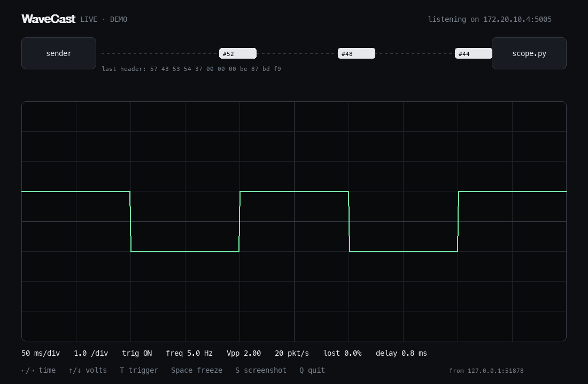

# WaveCast — Day 21

Send a signal over your network and watch it arrive on an oscilloscope. One program, the **sender**, makes a wave and fires it out as small **UDP packets**. A second program, the **scope**, catches the packets and draws them live, while counting lost packets and measuring the delay.

New to Python? Start with the [general beginner guide](../BEGINNER_GUIDE.md). It explains installing tools, environments, Terminal commands, commits, and pushing work to GitHub.

Inspired by the BuildCored **UDPOscilloscope** project card by Abdulboriy. WaveCast is our own pygame version with five wave shapes plus the microphone, a trigger, time and height zoom, flying packet animation, loss and delay counters, fake packet loss, and a self-test.



## What it is, in simple terms

An **oscilloscope** is a tool engineers use to *see* electrical signals: it draws how a value changes over time, very fast. WaveCast is a software oscilloscope whose signal travels over the network.

| Part | Job |
| --- | --- |
| **Sender** | Makes 1000 numbers per second, such as a sine wave, packs 50 of them into each packet, and sends 20 packets per second |
| **UDP** | The network delivery method. Fast and simple, but it never checks whether a packet arrived |
| **Scope** | Receives packets, puts the numbers in order, and draws them on a grid |

### What is inside one packet

```
W C S T | seq | send time | rate | count | 50 numbers
 4 bytes  4 B    8 B        2 B     2 B    50 × 4 bytes
```

- **WCST** is a "magic" label, so the scope ignores packets from other programs.
- **seq** is the packet number: 0, 1, 2, 3… If the scope sees #3 and then #5, it knows #4 was **lost**.
- **send time** lets the scope calculate the **delay**: arrival time minus send time.
- The header is 20 bytes, and each packet is 220 bytes in total.

### Why UDP and not TCP

| | UDP | TCP |
| --- | --- | --- |
| Speed | Fast, sends right away | Slower, waits for confirmations |
| Lost data | Just gone | Sent again automatically |
| Good for | Live sensors, video calls, games | Web pages, files, messages |

For live sensor data, an old packet is useless anyway, so it is better to skip it than to wait for it. That is why UDP is used.

### What the trigger does

Without a trigger, each new frame starts at a random point in the wave, so the picture runs across the screen. With the **trigger** on, the scope always starts drawing where the wave crosses zero going up, so the wave stands still. Real oscilloscopes do exactly this.

## Where it is used in real life

- **Drones and robots** stream sensor readings over Wi-Fi to a laptop for live graphs.
- **Video calls and online games** use UDP because speed matters more than every single packet.
- **Factories and labs** send sensor data from many devices to one monitoring screen.
- **Engineers** use real oscilloscopes to debug circuits, and network tools to measure packet loss and delay.

### How it connects to earlier days

| Day | Project | Link |
| --- | --- | --- |
| 15 | [AudioScope](../15-audioscope/) | Shows sound frequencies; WaveCast shows the raw wave |
| 17 | [DutyGlow](../17-dutyglow/) | Square waves, like WaveCast's `--wave square` |
| 19 | [BusTalk](../19-bustalk/) | Sending bytes between chips over wires |
| 20 | [SenseDeck](../20-sensedeck/) | Reading sensors on one computer |
| 21 | WaveCast | Sending sensor data to another computer |

No AI model is used today.

## Before starting

You need Python 3.12, uv, `pygame`, `numpy`, and `sounddevice`, listed in `requirements.txt`. A microphone is needed only for `--wave mic`. Installing packages needs internet once; after that, WaveCast works without internet on one computer. To use two computers, both must be on the same Wi-Fi. The example setup is macOS-first.

## Files

| Item | Purpose |
| --- | --- |
| `main.py` | Packets, waves, sender, receiver, scope drawing, controls, and self-test |
| `requirements.txt` | Package versions used when this project was built |
| `.gitignore` | Excludes the environment, cache files, and saved screenshots |
| `screenshot.png` | Example scope shown above |
| `.venv/` | Local Python environment |

## First-time setup

Paste this in Terminal as one line. It starts with `cd`, so it works from any folder:

```bash
cd ~/Documents/GitHub/30daychallenge/21-wavecast && uv venv --python 3.12 && uv pip install -r requirements.txt && pwd
```

It should print a path ending in `30daychallenge/21-wavecast`.

## Check

```bash
cd ~/Documents/GitHub/30daychallenge/21-wavecast && .venv/bin/python main.py --test
```

The check should end with:

```
11/11 checks passed
```

It checks packing and unpacking, ignoring strange packets, lost and late packet counting, the wave shapes, frequency measuring, the trigger, and a real UDP packet travelling through your own computer.

## Run

### Quickest: both in one window

```bash
cd ~/Documents/GitHub/30daychallenge/21-wavecast && .venv/bin/python main.py --demo --wave square
```

### The real way: two Terminal windows

Every new Terminal window starts in your home folder, so each command starts with `cd`.

Window 1, the scope:

```bash
cd ~/Documents/GitHub/30daychallenge/21-wavecast && .venv/bin/python main.py scope
```

Window 2, the sender:

```bash
cd ~/Documents/GitHub/30daychallenge/21-wavecast && .venv/bin/python main.py send --wave sine --freq 5
```

Press **Ctrl+C** in window 2 to stop sending; the scope switches to WAITING.

### Two computers on the same Wi-Fi

1. Run the scope on computer A and read the `listening on 172.x.x.x:5005` text at the top right.
2. On computer B, run the sender with that address:

```bash
cd ~/Documents/GitHub/30daychallenge/21-wavecast && .venv/bin/python main.py send --host 172.x.x.x
```

If macOS asks whether Python may accept incoming network connections, click **Allow**.

## Sender options

| Option | What it does |
| --- | --- |
| `--wave sine` | Shape: `sine`, `square`, `saw`, `triangle`, `noise`, or `mic` |
| `--freq 5` | Waves per second, in Hz |
| `--amp 1` | Wave height |
| `--drop 0.1` | Pretend the network loses 10% of packets |
| `--host IP` | Where to send; default `127.0.0.1`, meaning this computer |

The scope also accepts `--seconds N` to quit after N seconds.

## Scope controls

| Key | What happens |
| --- | --- |
| **←** / **→** | Time zoom: 5 to 500 ms per grid square |
| **↑** / **↓** | Height zoom: 0.1 to 2 units per grid square |
| **T** | Trigger on or off |
| **Space** | Freeze the picture |
| **S** | Save the screen as `wavecast.png` beside `main.py` |
| **Q** or **Esc** | Quit |

Click the scope window first if keys do nothing.

## Read the screen

| Part | Meaning |
| --- | --- |
| Flying boxes | Packets travelling from sender to scope; every 4th one is drawn with its number |
| `last header` | The first 12 bytes of the newest packet, in hex: `57 43 53 54` spells WCST |
| `ms/div`, `/div` | Size of one grid square in time and height |
| `freq` | Measured frequency of the wave |
| `Vpp` | Peak to peak: highest minus lowest value |
| `pkt/s` | Packets arriving per second; normally 20 |
| `lost` | Share of packets that never arrived; red above 1% |
| `delay` | Time from sending to arriving, in milliseconds |

## Check that it works

1. Run `--test` and confirm 11/11 checks pass.
2. Run the scope and the sender in two windows; confirm `LIVE`, `20 pkt/s`, and `freq 5.0 Hz`.
3. Press **T** to turn off the trigger and watch the wave run; press it again to stop it.
4. Restart the sender with `--drop 0.1` and confirm `lost` shows about 10%, in red.
5. Restart with `--wave mic` and talk.
6. Stop the sender and confirm the scope says `WAITING`.

## Settings you can change

Edit these near the top of `main.py`, save, and rerun both programs:

| Setting | Effect |
| --- | --- |
| `PORT` | Network port; sender and scope must match |
| `SAMPLE_RATE` | Numbers per second the sender makes |
| `PACKET_SAMPLES` | Numbers per packet; fewer means more packets per second |
| `BUFFER_SECONDS` | How much signal the scope remembers |
| `TIME_DIVS`, `VOLT_DIVS` | Zoom steps |
| `TRACE`, `BG`, `GRID` | Colors as red, green, blue values |

## Troubleshooting

| Problem | What to check |
| --- | --- |
| `can't open file '/Users/you/main.py'` | The Terminal is in your home folder. Use the full command that starts with `cd ~/Documents/GitHub/30daychallenge/21-wavecast`. |
| `no such file or directory: .venv/bin/python` | Same reason, or the environment is missing. Run the setup command. |
| Scope stays `WAITING` | The sender is not running, or `--host` is wrong. On one computer, leave out `--host`. |
| `Address already in use` | Another scope is already running. Close it, or change `PORT` in both programs. |
| Two computers do not connect | Same Wi-Fi? Allow incoming connections in the macOS prompt. Some school or office Wi-Fi blocks device-to-device traffic. |
| Wave runs across the screen | Press **T** to turn the trigger on. |
| Mic wave is flat | Allow Terminal in System Settings → Privacy & Security → Microphone, then speak louder or press **↑**. |

## What I practiced

Built with AI assistance: UDP sockets for sending and receiving, packing numbers into bytes with `struct`, packet headers and magic labels, sequence numbers for detecting lost and late packets, measuring network delay, running a receiver in a background thread with a lock, generating sine, square, saw, and triangle waves, oscilloscope triggering, measuring frequency from zero crossings, drawing a scope grid and trace in pygame, and a self-test that sends a real packet through localhost.
