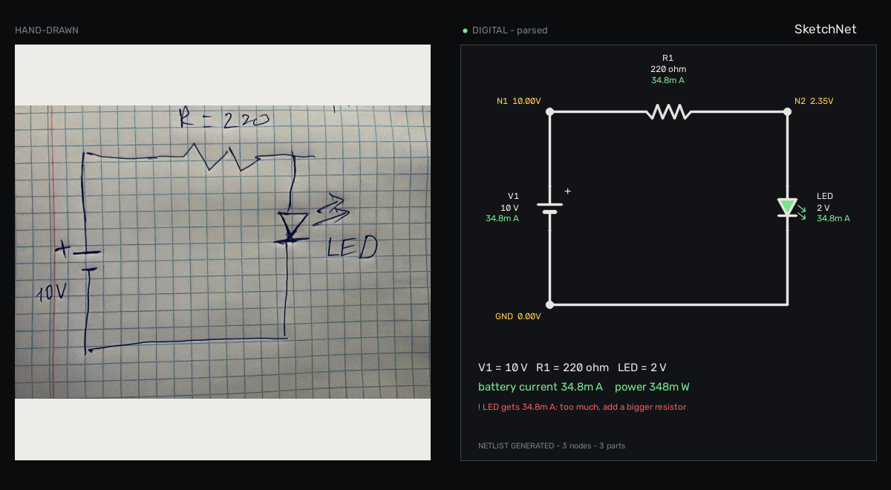

# SketchNet — Day 22

Draw a circuit on paper, take a photo, and let a **local AI** read it. SketchNet turns your drawing into a clean digital schematic, writes a **SPICE netlist**, and solves the circuit: the voltage at every point and the current through every part.

New to Python? Start with the [general beginner guide](../BEGINNER_GUIDE.md). It explains installing tools, environments, Terminal commands, commits, and pushing work to GitHub.

Inspired by the BuildCored **CircuitWhisperer** project card by Mehribon. SketchNet is our own version with a local Ollama vision model, a real circuit solver, a rectangle redraw of simple loops, LED warnings, a fix-it-yourself JSON step, a built-in demo drawing, and a self-test.



*Left: my drawing on grid paper. Right: what SketchNet understood — 10 V battery, 220 Ω resistor, LED, 34.8 mA flowing, and a warning that the LED gets too much current.*

## What it is, in simple terms

| Step | What happens |
| --- | --- |
| **1. Photo** | You draw a circuit and photograph it, or snap it with the webcam |
| **2. AI reads it** | A vision model on your own computer lists the parts, their values, and how they connect |
| **3. Clean up** | SketchNet fixes typical AI mistakes: odd names, missing values, values like `2k2` or `4.7k` |
| **4. Solve** | Real physics: Ohm's law and Kirchhoff's laws give every voltage and current |
| **5. Output** | A side-by-side picture, a SPICE netlist, and a parts list you can edit |

### Netlist, in simple terms

A **netlist** is a circuit written as text. Every wire junction gets a name, called a **node**, and every part says which two nodes it sits between:

```
* SketchNet netlist
V1 N1 0 DC 10       battery: + at N1, - at ground, 10 volts
R1 N1 N2 220        resistor: between N1 and N2, 220 ohms
DLED N2 0 LED       LED: from N2 down to ground
.op
.end
```

That is [example_netlist.cir](example_netlist.cir), made from my drawing. Node `0` is **ground**, the 0 V reference point. Simulators like **LTspice**, **ngspice**, and **KiCad** read this format.

### How the solver works

SketchNet uses **modified nodal analysis**, the same method SPICE uses:

- **Kirchhoff's current law:** the current flowing into every node equals the current flowing out.
- **Ohm's law:** the current through a resistor is voltage ÷ resistance.
- Each battery adds one rule: the voltage between its two sides is fixed.

All these rules form one set of equations, and `numpy` solves them in one step.

How each part is modelled:

| Part | Model |
| --- | --- |
| Battery | Fixed voltage |
| Resistor, lamp | Ohm's law |
| LED | Uses up about 2 V when on, plus a tiny 10 Ω resistance. If it points the wrong way, it blocks current |
| Diode | Uses up 0.7 V |
| Capacitor | Blocks steady current, so 0 A flows through it |
| Switch | Closed is a wire; open blocks current |
| Inductor | A wire for steady current |

### My circuit, worked by hand

10 V battery − 2 V for the LED = 8 V left for the resistor and the LED's small resistance:
8 V ÷ (220 Ω + 10 Ω) = **34.8 mA**. A normal LED wants about 20 mA, so SketchNet warns you to use a bigger resistor. With 390 Ω you get about 20 mA.

## Where it is used in real life

- **Engineers** sketch circuits on whiteboards; tools like this turn the sketch into a file for a simulator.
- **Digitizing old schematics:** factories and repair shops convert paper diagrams into files.
- **Education:** students check homework circuits instantly.
- **Circuit design tools** such as KiCad, LTspice, and Altium all describe circuits as netlists.
- **The same idea of photo → AI → structured data** is used for receipts, forms, maths homework, and handwritten notes.

### How it connects to earlier days

| Day | Project | Link |
| --- | --- | --- |
| 12 | [SnapAnnotator](../12-snapannotator/) | Also uses AI to understand a camera picture |
| 14 | [RegisterBot](../14-registerbot/) | Inside the chips these circuits power |
| 17 | [DutyGlow](../17-dutyglow/) | Dimming an LED with PWM |
| 22 | SketchNet | Reading and solving the circuit around the LED |

## Before starting

You need Python 3.12, uv, `opencv-python`, and `numpy`, listed in `requirements.txt`, plus **Ollama** with the vision model **qwen2.5vl:3b**, about 3.2 GB. The demo and the `--json` mode work without Ollama. A webcam is needed only for `--camera`. The example setup is macOS-first.

## Files

| Item | Purpose |
| --- | --- |
| `main.py` | AI request, parts cleanup, solver, netlist writer, drawing, camera, and self-test |
| `requirements.txt` | Package versions used when this project was built |
| `.gitignore` | Excludes the environment, cache files, and your latest outputs and photo |
| `screenshot.png` | My result, shown above |
| `example_circuit.jpg` | My hand-drawn circuit, to try SketchNet on |
| `example_netlist.cir` | The SPICE netlist SketchNet made from it |
| `sketchnet.png`, `circuit.cir`, `circuit.json` | Written on every run |

## First-time setup

Paste this in Terminal as one line. It starts with `cd`, so it works from any folder:

```bash
cd ~/Documents/GitHub/30daychallenge/22-sketchnet && uv venv --python 3.12 && uv pip install -r requirements.txt && pwd
```

Download the vision model once:

```bash
ollama pull qwen2.5vl:3b
```

If it says `i/o timeout`, your internet dropped; run it again and it continues.

## Check

```bash
cd ~/Documents/GitHub/30daychallenge/22-sketchnet && .venv/bin/python main.py --test
```

The check should end with:

```
14/14 checks passed
```

It checks value reading, number formatting, finding JSON in a chatty AI reply, rebuilding a loop when the AI gets the wiring wrong, Ohm's law, a voltage divider, parallel resistors, the LED circuit, a backwards LED, a capacitor, the netlist, the rectangle layout, and the drawing.

## Run

| Command | What it does |
| --- | --- |
| `.venv/bin/python main.py --demo` | Built-in drawing; no AI needed |
| `.venv/bin/python main.py example_circuit.jpg` | Read my example photo with the AI |
| `.venv/bin/python main.py photo.jpg` | Read your own photo |
| `.venv/bin/python main.py --camera` | Take the photo with the webcam: **Space** to snap, **Q** to quit |
| `.venv/bin/python main.py --json circuit.json` | Skip the AI and re-solve a parts list you fixed |
| `.venv/bin/python main.py --demo-ai` | Send the built-in drawing to the AI |
| `--model NAME` | Use another Ollama vision model |
| `--no-window` | Save the files without opening a window |

Run them from inside `22-sketchnet`, for example:

```bash
cd ~/Documents/GitHub/30daychallenge/22-sketchnet && .venv/bin/python main.py example_circuit.jpg
```

The first AI run takes about a minute while the model loads. Press any key in the result window to close it.

## How to draw so the AI understands

| Part | Draw it like this |
| --- | --- |
| Battery | One long line and one short line; write `+` by the long one and the voltage, e.g. `9V` |
| Resistor | A zigzag; write the value, e.g. `220` or `1k` |
| LED | A triangle with a bar at its tip, two small arrows, and the word `LED` |
| Capacitor | Two equal parallel lines; write e.g. `10uF` |
| Switch | A line lifted at an angle between two dots |
| Lamp | A circle with an X inside |

Tips:

- Use a dark pen and draw the wires as clear connected lines.
- Write every value next to its part.
- Photograph from straight above, with good light and no shadow on the drawing.
- Keep it simple: one loop works best with a small model.

## Read the result

| Part | Meaning |
| --- | --- |
| Yellow labels at dots | Node name and its voltage; `GND` is 0 V |
| Under each part | Name, value, and current in green |
| Green LED | The LED is on |
| `battery current`, `power` | Total current and power the battery gives |
| Red `!` lines | Warnings: backwards LED, too much LED current, a value the AI guessed, or two batteries fighting |
| A `?` after a name | The AI guessed that value because none was written |

## If the AI gets it wrong

Small vision models make mistakes. Open `circuit.json` in VS Code, fix the type, value, or `from` and `to` nodes, save, and run:

```bash
cd ~/Documents/GitHub/30daychallenge/22-sketchnet && .venv/bin/python main.py --json circuit.json
```

Rules for `circuit.json`: node `"0"` is ground, a battery's `from` is its + side, and an LED's `from` is its flat triangle side. You can also add `"layout": "series"` at the top to say "everything is one loop, in this order".

## Settings you can change

Edit these near the top of `main.py`, save, and rerun:

| Setting | Effect |
| --- | --- |
| `MODEL` | Ollama vision model |
| `PROMPT` | The instructions sent to the AI |
| `LED_DROP`, `DIODE_DROP` | Volts an LED or diode uses when on |
| `DEFAULTS` | Values used when nothing is written |
| `CAMERA_INDEX` | Which camera to use |

## Troubleshooting

| Problem | What to check |
| --- | --- |
| `Could not open .../circuit.jpg` | Wrong path. If the photo is inside `22-sketchnet`, use just `circuit.jpg`. |
| `Model qwen2.5vl:3b is not downloaded` | Run `ollama pull qwen2.5vl:3b`. |
| `i/o timeout` while pulling | Your internet dropped. Check Wi-Fi and run the pull again. |
| `Ollama is not running` | Open the Ollama app, or run `ollama serve` in another window. |
| Parts are wrong or missing | Draw darker, write values clearly, or fix `circuit.json` and use `--json`. |
| "points the wrong way" warning | Check the LED direction in the drawing or in `circuit.json`. |
| Enormous current | The battery is connected straight to itself: a short circuit. Add a resistor. |
| Camera does not open | Allow Terminal in System Settings → Privacy & Security → Camera. |

## What I practiced

Built with AI assistance: sending images to a local vision model through the Ollama API, writing a prompt that asks for JSON, pulling JSON out of a messy reply, cleaning AI output, reading values like `4.7k` and `2k2` with regular expressions, nodes and netlists, SPICE format, modified nodal analysis with numpy, modelling LEDs, diodes, capacitors, and switches, detecting a single loop in a graph, drawing schematic symbols with OpenCV, and a self-test that checks the physics without the AI.
