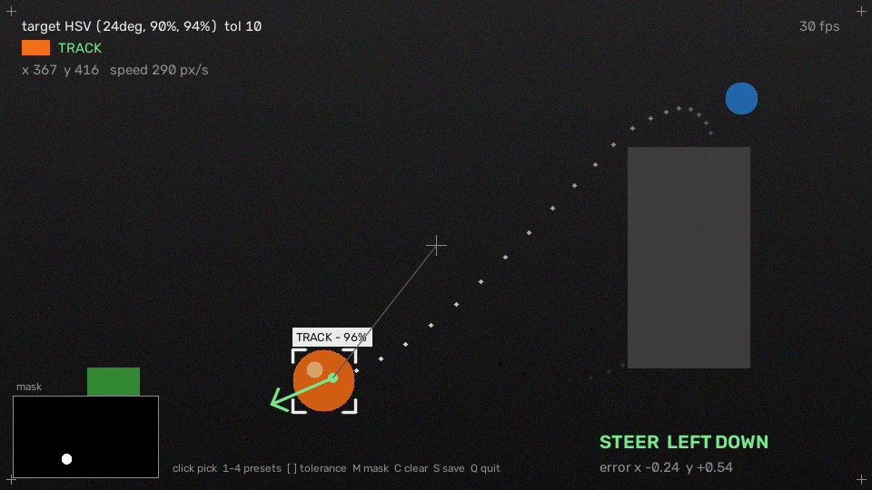

# HueHunter — Day 23

Point your webcam at a colored object, click it once, and HueHunter tracks it live: a box with a confidence score, a fading trail, speed and direction, a guess of where it went when it hides, and the steering command a robot would use to keep it in the middle of the camera.

New to Python? Start with the [general beginner guide](../BEGINNER_GUIDE.md). It explains installing tools, environments, Terminal commands, commits, and pushing work to GitHub.

Inspired by [Botirsherov/ObjectFollower](https://github.com/Botirsherov/ObjectFollower). HueHunter is our own OpenCV version with click-to-pick color, red hue wrap-around, smoothing, prediction when the object hides, steering output, a mask view, a demo scene, and a self-test.



*The demo: an orange ball is tracked at 96%; the dotted trail shows where it went, including behind the grey box, and the robot would steer LEFT DOWN.*

## What it is, in simple terms

No AI is used today. HueHunter uses classic **computer vision**: simple math on pixels, done 30 times a second.

| Step | What happens |
| --- | --- |
| **1. Pick a color** | You click the object; HueHunter averages the color of a small square around the click |
| **2. Change to HSV** | Each pixel is described by **hue** (which color), **saturation** (how strong), and **value** (how bright) |
| **3. Mask** | Every pixel close to the chosen hue becomes white, everything else black |
| **4. Clean up** | Tiny white specks are removed and small holes are filled |
| **5. Biggest blob** | The largest white area is the object; its center is calculated with image moments |
| **6. Track** | The center is smoothed, added to the trail, and its speed is measured |
| **7. Steer** | The distance from the frame center becomes LEFT, RIGHT, UP, DOWN, or CENTERED |

### Why HSV and not RGB

In RGB, a red ball in shadow and the same ball in sunlight have very different numbers. In **HSV**, the **hue** stays almost the same; only the brightness changes. So "find this hue" works in different light.

Red is special: its hue sits at both ends of the circle, near 0 and near 179 in OpenCV. HueHunter checks both ends, so red works too.

### Confidence

The percentage mixes three things:

- **Solid:** the blob has no big dents.
- **Round:** how close the blob is to a circle.
- **Alone:** how much of all matching pixels belong to this one blob. Other things of the same color lower it.

### When the object hides

If the object disappears, HueHunter keeps moving the dot in the last direction and slows it down: **PREDICT**, in orange. If it does not come back within 20 frames, about 1 second, the state becomes **LOST**.

## Where it is used in real life

- **Robots and drones** that follow a ball, a person's jacket, or a landing marker.
- **Pan-tilt cameras** that turn to keep a speaker or a player in frame; the STEER line is exactly their input.
- **Sports:** early ball-tracking systems used color.
- **Factories:** robots sort fruit or parts by color on a conveyor belt.
- **Games and art:** laser-pointer games, and the same idea as [AirCanvas](../02-aircanvas/) on Day 2.

### How it connects to earlier days

| Day | Project | Link |
| --- | --- | --- |
| 2 | [AirCanvas](../02-aircanvas/) | Drawing by following something in the camera |
| 12 | [SnapAnnotator](../12-snapannotator/) | Finding objects with AI; HueHunter uses color instead |
| 18 | [DepthPaint](../18-depthpaint/) | Another way of reading meaning from camera pixels |
| 23 | HueHunter | Tracking and steering toward one object |

## Before starting

You need Python 3.12, uv, `opencv-python`, and `numpy`, listed in `requirements.txt`, and a webcam. No AI model or internet is needed after installing. The demo works without a camera. The example setup is macOS-first.

## Files

| Item | Purpose |
| --- | --- |
| `main.py` | Color picking, mask, blob finding, tracker, steering, drawing, demo, and self-test |
| `requirements.txt` | Package versions used when this project was built |
| `.gitignore` | Excludes the environment, cache files, and saved screenshots |
| `screenshot.png` | Example frame from the demo |
| `.venv/` | Local Python environment |

## First-time setup

Paste this in Terminal as one line. It starts with `cd`, so it works from any folder:

```bash
cd ~/Documents/GitHub/30daychallenge/23-huehunter && uv venv --python 3.12 && uv pip install -r requirements.txt && pwd
```

## Check

```bash
cd ~/Documents/GitHub/30daychallenge/23-huehunter && .venv/bin/python main.py --test
```

The check should end with:

```
13/13 checks passed
```

It checks the hue ranges, red wrap-around, picking a color by click, finding the biggest blob and ignoring other colors, confidence, smoothing, speed, PREDICT and LOST, steering words, and the demo ball.

## Run

Demo, no camera needed:

```bash
cd ~/Documents/GitHub/30daychallenge/23-huehunter && .venv/bin/python main.py --demo
```

With the webcam:

```bash
cd ~/Documents/GitHub/30daychallenge/23-huehunter && .venv/bin/python main.py
```

Hold up something with a strong color, such as a red cap, a green marker, a yellow sticky note, or an orange, and **click it** in the window. The first run makes macOS ask Terminal for **Camera** permission; allow it and run again.

`--seconds N` quits automatically after N seconds.

## Controls

| Key | What happens |
| --- | --- |
| **Click** | Pick the color under the mouse |
| **1** / **2** / **3** / **4** | Preset colors: red, green, blue, yellow |
| **[** / **]** | Color tolerance: stricter or looser |
| **M** | Show the full mask: white pixels are what HueHunter thinks is your color |
| **C** | Clear the trail |
| **S** | Save the screen as `huehunter.png` beside `main.py` |
| **Q** or **Esc** | Quit |

Click the window first if keys do nothing.

## Read the screen

| Part | Meaning |
| --- | --- |
| `target HSV (24deg, 90%, 94%)` | The chosen color: hue in degrees, saturation, brightness; the small swatch shows it |
| `TRACK - 96%` | Box around the object and the confidence |
| Dotted trail | Where the object has been; older points are fainter |
| Green arrow | Direction and speed |
| `PREDICT`, orange | The object is hidden; this is a guess |
| `LOST`, red | Hidden for too long |
| Line from the middle cross | How far the object is from the center |
| `STEER LEFT DOWN` | How a camera robot should turn |
| `error x -0.24 y +0.54` | The same as numbers, from -1 to 1; a robot motor would use these |
| `mask` box | Small live view of the mask |

## Tips for good tracking

- Choose a color that is not in your background, clothes, or skin.
- Bright, matte objects work best; shiny ones have white reflections.
- Even light helps; very dark rooms make colors grey.
- If the box jumps to other things, press **[** to be stricter. If it loses the object, press **]**.
- Press **M** to see what HueHunter sees.

## Settings you can change

Edit these near the top of `main.py`, save, and rerun:

| Setting | Effect |
| --- | --- |
| `HUE_TOL` | Starting color tolerance |
| `MIN_SAT`, `MIN_VAL` | Ignore greyish and dark pixels below these |
| `MIN_AREA` | Smallest blob that counts, in pixels |
| `SMOOTH` | 0 is fast and jumpy; closer to 1 is smooth and slow |
| `TRAIL` | Trail length |
| `PREDICT_FRAMES` | How long to guess before LOST |
| `DEADZONE` | How close to the middle counts as CENTERED |
| `MIRROR` | Flip the webcam like a mirror |
| `CAMERA_INDEX` | Which camera to use |
| `PRESETS` | Colors for keys 1 to 4 |

## Troubleshooting

| Problem | What to check |
| --- | --- |
| `Could not open the camera` | Allow Terminal in System Settings → Privacy & Security → Camera, close other camera apps, or try `--demo`. |
| Nothing is tracked | Click directly on the object, or press **]** for more tolerance. |
| It tracks the wrong thing | Something else has the same color. Press **[**, or move it out of view. |
| Box flickers | Better light, or a bigger object. |
| Red does not work | Click the red object instead of using the preset, so HueHunter learns your exact red. |
| OpenCV prints an `AVCaptureDeviceTypeExternal` warning | Harmless on macOS; ignore it. |

## What I practiced

Built with AI assistance: HSV color space, averaging hues on a circle, thresholding with `inRange`, handling red's hue wrap-around, morphology to clean masks, contours and image moments, roundness and solidity, exponential smoothing, velocity, predicting a hidden object, turning position error into steering commands, mouse and keyboard events in OpenCV, a synthetic demo scene, and a self-test on generated images.
